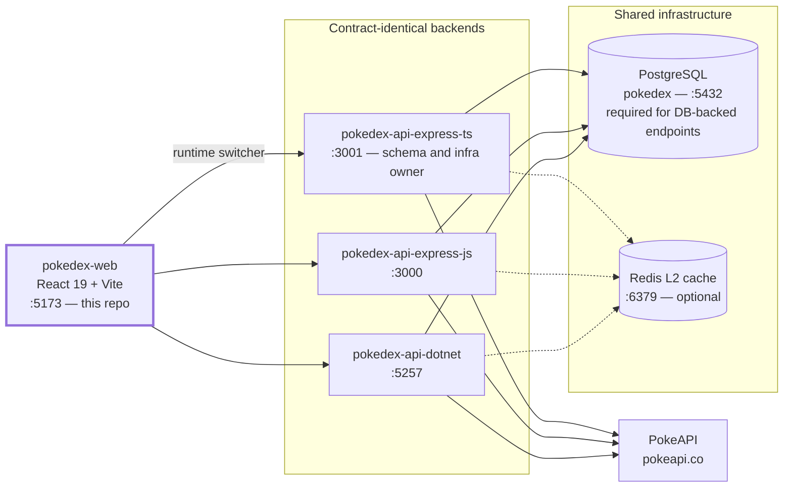

# Pokedex Web

React frontend for the pokedex ecosystem — **React 19 + Vite + TypeScript**, Redux Toolkit with RTK Query, Tailwind CSS v4 over Radix primitives, `react-i18next`. It renders the shared Pokedex against **any of the three contract-identical backends** and can flip between them live from a header dropdown: because the backends return byte-identical responses and issue interchangeable JWTs against one shared database, a session started on one service keeps working after switching to another. Its own differentiators are **nine Pokemon-game themes** (each with its own hand-drawn pokeball brand mark), a hand-rolled bottom-left **toast** system carrying all transient feedback, debounced id/name **search**, a toggleable pagination-vs-**virtualized-infinite-scroll** browse grid, a redesigned detail page with a themed **capture** animation, **en/es i18n**, and a fully silent **token-rotation session layer**.

## Ecosystem overview

Four repositories make up the ecosystem. The three backends are **contract-identical**: same routes, same `{ data, error, msg, meta }` envelope (byte-identical wire responses, verified by live parity gates during development), same bcrypt/JWT parameters, and they share **one PostgreSQL database plus one JWT signing key** — a token minted by any of the three is accepted by the other two, which is exactly what makes this frontend's live backend switcher safe to use mid-session. The most common way that guarantee breaks locally is the .NET backend's dev signing key drifting from the Node services' `JWT_SECRET`: it lives in `dotnet user-secrets` rather than a checked-in file, so it has to be set to match by hand (see [Troubleshooting](#troubleshooting)).

| Repo | Stack | Port | Role |
|---|---|---|---|
| [`pokedex-api-express-ts`](../pokedex-api-express-ts) | Node 22, Express 5, TypeScript, Drizzle | 3001 | Backend — reference implementation; **schema + infra owner** |
| [`pokedex-api-express-js`](../pokedex-api-express-js) | Node 22, Express 5, JavaScript (ESM) | 3000 | Backend — plain-JS mirror |
| [`pokedex-api-dotnet`](../pokedex-api-dotnet) | ASP.NET Core (.NET 10), EF Core, Npgsql | 5257 | Backend — database-first EF mapping |
| [`pokedex-web`](.) | React 19, Vite, TypeScript | 5173 | Frontend — **this repo** |



## Architecture

Presentation-component split, deliberately without over-abstraction: `pages/` are the containers (data wiring, page state), `components/` are presentational, and everything stateful funnels through the Redux store.

```
src/
├── main.tsx                      # Bootstrap: Redux Provider, ThemeProvider, ToastProvider, i18n side-effect import, App
├── App.tsx                       # SessionBootstrap (silent refresh on boot) + react-router routes
├── pages/                        # Containers: BrowsePage, DetailPage, CollectionPage (protected),
│                                 # LoginPage, RegisterPage, NotFoundPage
├── components/
│   ├── auth/                     # RequireAuth — route guard redirecting anonymous users to /login
│   ├── brand/                    # PokeballMark + THEME_POKEBALL/POKEBALL_PALETTES — the themed pokeball marks
│   ├── capture/                  # CaptureAnimation (+ its keyframes), CaptureSprite, CapturedBadge
│   ├── collection/               # CollectionEntryCard, EditLocalDialog, DeleteConfirmDialog
│   ├── layout/                   # Header, BackendSwitcher, LanguageSwitcher
│   ├── pokemon/                  # PokemonCard, StatBars, EvolutionChain, PaginationControls, BrowseModeToggle
│   ├── search/                   # PokemonSearch — debounced id/name quick-jump over the detail endpoints
│   └── ui/                       # Radix-based primitives (Button, Card, Dialog, Select, Input, Badge, …)
│                                 # plus the hand-rolled Toast/ToastProvider
├── store/
│   ├── Store.ts                  # configureStore: api + auth + apiTarget + ui reducers
│   ├── Api.ts                    # RTK Query: dynamic base URL, reauth-on-401 wrapper, all endpoints
│   ├── AuthSlice.ts              # Access token + user IN MEMORY only
│   ├── RefreshTokenStorage.ts    # Refresh token in localStorage (the one persisted secret)
│   ├── ApiTargetSlice.ts         # Backend switcher state (persisted)
│   └── UiSlice.ts                # Page-size + browse-mode preferences (persisted)
├── i18n/                         # i18next setup + locales/en.json, locales/es.json
├── themes/                       # ThemeProvider + themes.css — the nine palettes as CSS variable sets
├── hooks/                        # UseTheme, UseDocumentTitle, UseToast, UseDebouncedValue,
│                                 # UseInfiniteScroll, UseVirtualList, UseCaptureSequence
└── lib/                          # Cn (class merge), Format, Validation, ApiErrorMessage helpers
```

### Routes

| Path | Page | Access |
|---|---|---|
| `/` | Pokedex browse — search + paginated or infinite-scroll grid | Public |
| `/pokemon/:idOrName` | Detail — artwork with catch/capture, dossier (types/abilities/stats), evolution chain, description | Public |
| `/collection` | My Collection — local replicas with sync/edit/delete | **Protected** (`RequireAuth`) |
| `/login`, `/register` | Auth forms | Public |
| `*` | Not found | Public |

### Store design (RTK Query + reauth)

All API data flows through one RTK Query API ([`src/store/Api.ts`](src/store/Api.ts)); plain slices hold `auth`, `apiTarget`, and `ui` state.

- **Dynamic base query**: the base URL is read from the `apiTarget` slice on *every* request, so switching backends takes effect on the next call without recreating the store.
- **Reauth wrapper**: any non-auth request that returns **401** triggers one `POST /api/auth/refresh` and retries the original request once; if the refresh fails, the session is cleared (logout). Concurrent 401s share a single in-flight refresh promise, so parallel queries never race multiple rotations — important because the backends treat refresh-token reuse as a theft signal and revoke the whole family.
- **Session storage split**: the access token and user live only in Redux memory; the refresh token is the single persisted secret, in `localStorage` (`pokedex.refreshToken`) — an accepted, documented trade-off so sessions survive reloads.
- **Silent bootstrap**: on app boot, `SessionBootstrap` checks for a stored refresh token. None → render immediately (anonymous, zero flash). Present → fire exactly one refresh behind a minimal full-page loader; success restores the session, failure renders anonymous.
- **Capture state**: `getLocalByPokeApiId` (`GET /api/pokemons/local/by-poke-api-id/:pokeApiId`) answers whether the signed-in user already has a given Pokemon in their collection; a 404 means "not yet" and is read as a state, not an error. It shares the `Local` cache tag with `syncById`, so a successful catch invalidates and refetches the check with no manual refetch call.

### Backend switcher

[`src/store/ApiTargetSlice.ts`](src/store/ApiTargetSlice.ts) knows the three services:

| Target | Base URL | i18n label key |
|---|---|---|
| `dotnet` (default) | `http://localhost:5257` | `backend.dotnet` |
| `expressJs` | `http://localhost:3000` | `backend.expressJs` |
| `expressTs` | `http://localhost:3001` | `backend.expressTs` |

Initial target resolution: persisted choice (`localStorage` `pokedex.apiTarget`) → `VITE_API_BASE_URL` matched against the known base URLs → `dotnet`. The header dropdown persists every change.

### Theme system & pokeball marks

Nine themes, each a complete CSS custom-property set on `:root[data-theme="..."]` in [`src/themes/themes.css`](src/themes/themes.css), mapped once to Tailwind v4 tokens in `src/index.css` (`@theme inline`) — components only ever use token utilities (`bg-background`, `text-foreground`, …), never raw colors.

| Theme | Inspiration | Background | Primary | Secondary | Accent |
|---|---|---|---|---|---|
| `emerald` (default) | Pokemon Emerald — GBA menu warmth, cream panels framed in green with gold | `#F4F1E0` | `#0FA36B` | `#1E5B4A` | `#D9A441` |
| `ruby` | Pokemon Ruby — Groudon's magma-chamber charcoal, molten red, lava-orange | `#17110E` | `#F4703C` | `#4D3D34` | `#F2A13A` |
| `sapphire` | Pokemon Sapphire — Kyogre's abyssal navy over ice-blue, crimson markings | `#EAF2FA` | `#14468C` | `#0D7490` | `#CF3446` |
| `firered` | Pokemon FireRed — warm, energetic, red-dominant | `#FFF6EC` | `#DB330D` | `#F57C00` | `#FFC107` |
| `leafgreen` | Pokemon LeafGreen — Venusaur's bright leaf green, sky-blue, soft pink bloom | `#F1F7E6` | `#1F7A3A` | `#2F77B8` | `#F4A7BD` |
| `diamond` | Pokemon Diamond — Dialga's brushed platinum, steel-blue, temporal teal | `#EDF1F5` | `#2F5C85` | `#55697D` | `#0C94A0` |
| `pearl` | Pokemon Pearl — Palkia's pearlescent white, rose, spatial violet | `#FDF6FA` | `#BF2E6D` | `#EDDFF4` | `#7C3AED` |
| `bw-light` | Pokemon Black & White — stark light half, Reshiram-blue accent | `#FFFFFF` | `#111111` | `#E5E5E5` | `#3B82F6` |
| `bw-dark` | Pokemon Black & White — OLED-dark half, Zekrom-cyan accent | `#0C0C0E` | `#F2F2F2` | `#26262B` | `#22D3EE` |

The `bw-light`/`bw-dark` pair doubles as the app's light/dark modes. Each theme also owns its own `--radius` — from `0.125rem` on `diamond` (crystalline) to `1rem` on `pearl` (pearlescent) — and, added alongside the toast system, its own `--success`/`--info` tokens distinct from `--primary`/`--accent`: status color can't safely borrow from the decorative palette, since e.g. `firered`'s primary is already red and `sapphire`'s accent is already a crimson. The theme choice is persisted (`localStorage` `pokedex.theme`) and applied by an inline script in [`index.html`](index.html) **before first paint**, so there is no flash of the default theme. Several hexes deviate slightly from the original game palettes to meet WCAG AA contrast — each deviation is documented at the top of `themes.css`.

Each theme also throws its own pokeball: `PokeballMark` ([`src/components/brand/PokeballMark.tsx`](src/components/brand/PokeballMark.tsx)) is a hand-authored SVG rendered in **game-accurate ball colors**, not theme tokens — a Nest Ball stays leaf-green and gold no matter which theme is active — with the theme-to-ball mapping fixed in `THEME_POKEBALL`:

| Theme | Ball |
|---|---|
| `emerald` | Nest |
| `ruby` | Level |
| `sapphire` | Dive |
| `firered` | Repeat |
| `leafgreen` | Friend |
| `diamond` | Net |
| `pearl` | Heal |
| `bw-light` | Premier |
| `bw-dark` | Luxury |

The mark shows up small in the header next to the theme switcher, and much larger as the ball thrown in the [capture animation](#detail-page--capture).

### i18n

`react-i18next` with `en` and `es` bundles ([`src/i18n/locales/`](src/i18n/locales)). Detection order: `localStorage` (`pokedex.language`) → browser language, fallback `en`; the header switcher persists the choice, and `<html lang>` stays in sync for assistive tech.

To add a language: create `src/i18n/locales/<lng>.json` (copy `en.json` as the key template), then register it in [`src/i18n/I18n.ts`](src/i18n/I18n.ts) — add the import, an entry in `resources`, and the code in `SUPPORTED_LANGUAGES` — and give the switcher a label for it.

### Toast notifications

All transient feedback — server errors on login/register, catch/sync results, retry failures — routes through one hand-rolled toast system ([`useToast`](src/hooks/UseToast.ts) + [`ToastProvider`](src/components/ui/Toast.tsx)), deliberately **not** `@radix-ui/react-toast`: Radix's `Root` hard-codes `role="status"` and derives `aria-live` from its own `type`, which fights the "errors must interrupt, successes must not" split this app needs, and it has no notion of a capped stack with the oldest dropping. The whole thing is a portal, a list, timers, and an exit animation.

Toasts render through a portal on `document.body`, stack **bottom-left**, and are announced correctly for the message: `role="status"`/`aria-live="polite"` for success and info, `role="alert"`/`aria-live="assertive"` for errors. Each toast auto-dismisses after 5s (7s for errors), pausing its countdown while hovered or focused, and always has a visible close button. Field-level validation (e.g. "invalid email") stays inline next to the input it's about; anything the *server* says — including login/register failures, which used to render as an in-form error block — is a toast instead.

### Search, pagination & infinite scroll

The browse toolbar carries a **debounced quick-jump search** ([`PokemonSearch`](src/components/search/PokemonSearch.tsx)): typing settles for 350ms (`useDebouncedValue`, [`src/hooks/UseDebouncedValue.ts`](src/hooks/UseDebouncedValue.ts)) before it resolves against the existing detail endpoints — an all-digit query hits `GET /api/pokemons/:id`, anything else hits `GET /api/pokemons/name/:name`. It does not filter the grid underneath; it floats a jump-to-detail result panel over it, and a non-404 failure toasts while a miss stays inline.

The grid itself has two interchangeable browse modes, switched from a toolbar toggle and persisted under `localStorage` `pokedex.browseMode`:

- **Pagination** (default) — the classic pager; page size is user-customizable, **10 / 20 / 50** (default 20) via a selector rendered next to the pager, and persisted in `localStorage` (`pokedex.pageSize`). The value is passed straight through to the backends' `pageSize` query param; `meta.totalPages` drives the pager.
- **Infinite** — `useInfiniteScroll` ([`src/hooks/UseInfiniteScroll.ts`](src/hooks/UseInfiniteScroll.ts)) fires the next page from an `IntersectionObserver` sentinel below the grid; the same page-size setting doubles as the batch size, so each load-more fetches one more page of that size. `useVirtualList` ([`src/hooks/UseVirtualList.ts`](src/hooks/UseVirtualList.ts)) then windows the accumulated list against row/column metrics measured off the grid's own rendered CSS, so only the visible rows (plus overscan) are mounted at once — hand-rolled rather than a virtualization dependency, since the whole job is one scroll listener plus two spacer heights.

Switching modes always lands on a clean first page, in either direction.

### Detail page & capture

The detail page is a two-column grid: a name plate rides the top of the artwork card, the catch/resync button is anchored **half off the artwork card's bottom edge** — the one control the page is really about — a right-hand "dossier" column carries types, quick facts, abilities, stats, and evolution mini-cards, and the description sits in its own card directly beneath the artwork, matching its width.

Catching runs a themed sequence (`useCaptureSequence`, [`src/hooks/UseCaptureSequence.ts`](src/hooks/UseCaptureSequence.ts)): a "already captured?" check against `GET /api/pokemons/local/by-poke-api-id/:pokeApiId` decides whether the button reads "Catch" or "Resync," and a successful catch shows a **Captured** badge with the capture date. The throw — the active theme's own pokeball arcing in, absorbing the sprite, wobbling on landing, then either bursting into sparks or splitting back open — is drawn with plain CSS keyframes ([`CaptureAnimation.css`](src/components/capture/CaptureAnimation.css)), no animation library, and is skipped entirely under `prefers-reduced-motion: reduce` — the sequence never leaves its `idle` phase, and only the real request plus its toast/badge outcome still happen.

## Prerequisites

### Required

| Dependency | Version | Notes |
|---|---|---|
| Node.js | 22 (see [`.nvmrc`](.nvmrc)) | `nvm use` picks it up |
| At least one backend | any of the three | Browse/detail need **only** a backend (backends serve them without a database); auth and My Collection additionally need the backend's PostgreSQL set up |

### Optional

- **The other two backends** — only needed to actually exercise the switcher.
- **Internet access for Google Fonts** — see [Troubleshooting](#troubleshooting).

## Configuration

```bash
cp .env.example .env   # optional — the app works with no .env at all
```

| Variable | Default | Required | Notes |
|---|---|---|---|
| `VITE_API_BASE_URL` | — (falls back to the `dotnet` target, `http://localhost:5257`) | No | Initial backend; must be one of the three known base URLs to match a switcher target. A persisted switcher choice **overrides** it on subsequent visits |

**CORS note:** nothing to configure here — all three backends ship a permissive CORS policy for browser clients by design (Bearer-token auth, no cookies, so `AllowAnyOrigin` cannot leak session state).

## Running

```bash
nvm use            # Node 22
npm install
npm run dev        # Vite dev server — http://localhost:5173
```

Open **http://localhost:5173** with at least one backend running (e.g. `dotnet run --project src/PokedexApi.Api --launch-profile http` in the .NET repo, or `npm run dev` in either Node repo).

| Script | Purpose |
|---|---|
| `npm run dev` | Vite dev server with HMR (port 5173) |
| `npm run build` | Type-check (`tsc -b`) + production bundle to `dist/` |
| `npm run preview` | Serve the production build locally |
| `npm run lint` | ESLint (flat config: TS + React + hooks + react-refresh) |
| `npm run typecheck` | `tsc -b --noEmit` |

## Session handling (what to expect as a user)

1. **Register/Login** — the backend returns a user, a 15-minute access JWT (kept in memory) and a 24-hour refresh token (kept in `localStorage`).
2. **Browsing stays uninterrupted** — when the access token expires, the first 401 triggers a silent refresh + retry; you never see it.
3. **Reloads keep you signed in** — the stored refresh token silently re-establishes the session at boot.
4. **After 24 hours** (absolute, from login) the refresh family dies server-side and you are asked to log in again.
5. **Switching backends keeps your session** — tokens are cross-service by contract.

## Testing

**No test suite — by design** (owner's call for this phase: unit tests live in the backends; the ecosystem spec keeps FE tests out of scope). The quality gates for this repo are:

```bash
npm run lint && npm run typecheck && npm run build
```

all of which pass clean, plus live browser verification of every page against all three backends during development.

## Troubleshooting

| Symptom | Explanation |
|---|---|
| Wrong/unexpected backend after changing `.env` | A previously persisted switcher choice (`localStorage` `pokedex.apiTarget`) overrides `VITE_API_BASE_URL`. Switch via the header dropdown or clear the key |
| Everything 401s / instant logouts (especially right after switching to the .NET target) | The backends must share the **same** JWT signing key, issuer and audience — if they diverge, tokens minted by one are rejected by another and the reauth loop logs you out. The most common cause is the .NET backend's `dotnet user-secrets` signing key drifting from the Node services' `JWT_SECRET`; realign it and restart. Also check the target backend can reach the shared PostgreSQL |
| Fonts look different offline | The display fonts (Atkinson Hyperlegible, Pixelify Sans) load from Google Fonts in `index.html`; offline, the browser falls back to system fonts. Cosmetic only |
| Upgrading ESLint to 10 breaks `npm run lint` | Deliberate pin: `eslint-plugin-react` declares peer support only up to ESLint `^9.7`, so this repo stays on ESLint 9 until the plugin catches up |
| Port 5173 in use | Another Vite instance is running; Vite will offer the next free port, but the backends' CORS policy is permissive so any port works |
| Empty browse grid | The selected backend isn't running (check the header switcher), or it can't reach PokeAPI — the grid needs no database, only the backend + upstream |

## Ecosystem siblings

- [`../pokedex-api-express-ts`](../pokedex-api-express-ts) — TypeScript reference backend, schema + infra owner (port 3001)
- [`../pokedex-api-express-js`](../pokedex-api-express-js) — plain-JS mirror backend (port 3000)
- [`../pokedex-api-dotnet`](../pokedex-api-dotnet) — ASP.NET Core backend (port 5257)

Design charter: [`../pokedex-api-express-ts/docs/superpowers/specs/2026-08-14-pokedex-ecosystem-design.md`](../pokedex-api-express-ts/docs/superpowers/specs/2026-08-14-pokedex-ecosystem-design.md).
