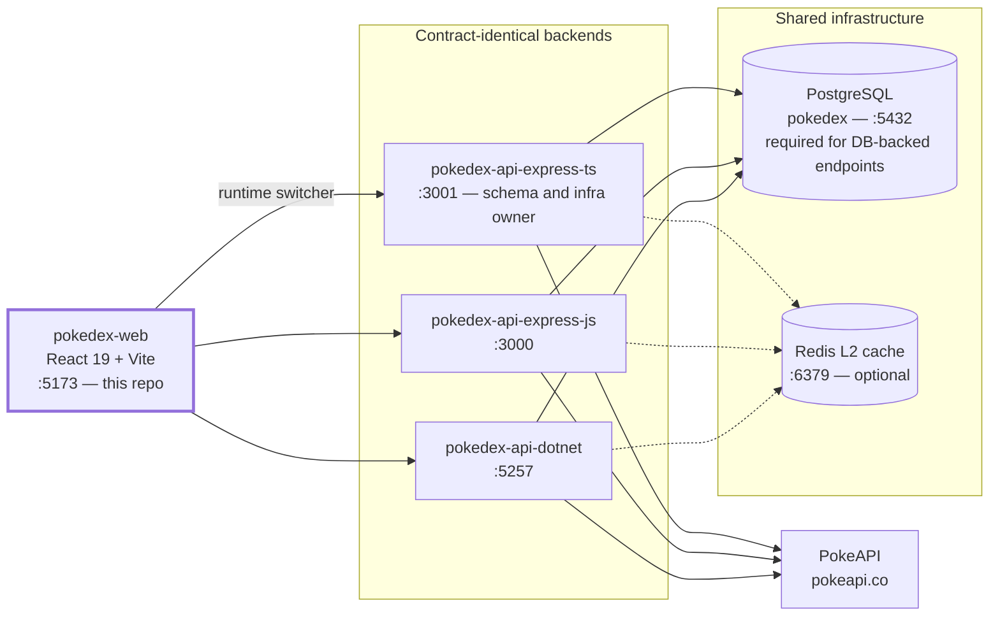

# Pokedex Web

React frontend for the pokedex ecosystem — **React 19 + Vite + TypeScript**, Redux Toolkit with RTK Query, Tailwind CSS v4 over Radix primitives, `react-i18next`. It renders the shared Pokedex against **any of the three contract-identical backends** and can flip between them live from a header dropdown: because the backends return byte-identical responses and issue interchangeable JWTs against one shared database, a session started on one service keeps working after switching to another. Its own differentiators are **nine Pokemon-game themes** (each with its own hand-drawn pokeball brand mark), a hand-rolled bottom-left **toast** system carrying all transient feedback, debounced id/name **search**, a toggleable pagination-vs-**virtualized-infinite-scroll** browse grid, a redesigned detail page with a themed **capture** animation, the **pokeball economy** on top of it — a wallet, a ball shop, a probabilistic catch you can lose, and a slot machine to fund it — a header that fits **one row at every width** (a drawer below `xl`, the full bar above), **en/es i18n**, and a **token-rotation session layer** silent enough to survive a phone's reload-and-background churn.

## Ecosystem overview

Four repositories make up the ecosystem. The three backends are **contract-identical**: same routes, same `{ data, error, msg, meta }` envelope (byte-identical wire responses, verified by live parity gates during development), same bcrypt/JWT parameters, and they share **one PostgreSQL database plus one JWT signing key** — a token minted by any of the three is accepted by the other two, which is exactly what makes this frontend's live backend switcher safe to use mid-session. The most common way that guarantee breaks locally is the .NET backend's dev signing key drifting from the Node services' `JWT_SECRET`: it lives in `dotnet user-secrets` rather than a checked-in file, so it has to be set to match by hand (see [Troubleshooting](#troubleshooting)).

| Repo | Stack | Port | Role |
|---|---|---|---|
| [`pokedex-api-express-ts`](../pokedex-api-express-ts) | Node 22, Express 5, TypeScript, Drizzle | 3001 | Backend — reference implementation; **schema + infra owner** |
| [`pokedex-api-express-js`](../pokedex-api-express-js) | Node 22, Express 5, JavaScript (ESM) | 3000 | Backend — plain-JS mirror |
| [`pokedex-api-dotnet`](../pokedex-api-dotnet) | ASP.NET Core (.NET 10), EF Core, Npgsql | 5257 | Backend — database-first EF mapping |
| [`pokedex-web`](.) | React 19, Vite, TypeScript | 5173 | Frontend — **this repo** |



## Architecture

Presentation-component split, deliberately without over-abstraction: `pages/` are the containers (data wiring, page state), `components/` are presentational, and everything stateful funnels through the Redux store.

```
src/
├── main.tsx                      # Bootstrap: Redux Provider, ThemeProvider, ToastProvider, i18n side-effect import, App
├── App.tsx                       # SessionBootstrap (restore-then-refresh on boot) + react-router routes
├── pages/                        # Containers: BrowsePage, DetailPage, CollectionPage (protected),
│                                 # ShopPage (protected), SlotsPage (protected),
│                                 # LoginPage, RegisterPage, NotFoundPage
├── components/
│   ├── auth/                     # RequireAuth — route guard redirecting anonymous users to /login
│   ├── brand/                    # PokeballMark + THEME_POKEBALL/POKEBALL_PALETTES — the themed pokeball marks
│   ├── capture/                  # CaptureAnimation (+ its keyframes), CaptureSprite, CapturedBadge,
│   │                             # BallPicker + BallOptions — the belt the throw draws from
│   ├── collection/               # CollectionEntryCard, EditLocalDialog, DeleteConfirmDialog
│   ├── economy/                  # WalletChip, BallShopCard/BallArt/QuantityStepper (shop),
│   │                             # SlotMachine/SlotReel/SlotResultPanel/SpinHistoryList (+ SlotsMachine.css),
│   │                             # EconomyFormat, QuantityRules, SlotSymbols, UseSlotSequence
│   ├── layout/                   # Header (one row at every width), HeaderMenu (the sub-xl drawer),
│   │                             # NavItems (the single nav source), BackendSwitcher, LanguageSwitcher, ThemeSwitcher
│   ├── pokemon/                  # PokemonCard, StatBars, EvolutionChain, PaginationControls, BrowseModeToggle
│   ├── search/                   # PokemonSearch — debounced id/name quick-jump over the detail endpoints
│   └── ui/                       # Radix-based primitives (Button, Card, Dialog, Sheet, Select, Input, Badge, …)
│                                 # plus the hand-rolled Toast/ToastProvider
├── store/
│   ├── Store.ts                  # configureStore: api + auth + apiTarget + ui reducers
│   ├── Api.ts                    # RTK Query: dynamic base URL, reauth-on-401 wrapper, all endpoints
│   ├── AuthSlice.ts              # Session state; hydrates itself from the stored access token on boot
│   ├── AccessTokenStorage.ts     # Access token in localStorage + its JWT `exp` guard
│   ├── RefreshTokenStorage.ts    # Refresh token in localStorage
│   ├── ApiTargetSlice.ts         # Backend switcher state (persisted)
│   └── UiSlice.ts                # Page-size + browse-mode preferences (persisted) + the slots reveal lock
├── i18n/                         # i18next setup + locales/en.json, locales/es.json
├── themes/                       # ThemeProvider + themes.css — the nine palettes as CSS variable sets
├── hooks/                        # UseTheme, UseDocumentTitle, UseToast, UseDebouncedValue,
│                                 # UseInfiniteScroll, UseVirtualList, UseCaptureSequence, UseSpinLockedValue
└── lib/                          # Cn (class merge), Format, Validation, ApiErrorMessage helpers
```

### Routes

| Path | Page | Access |
|---|---|---|
| `/` | Pokedex browse — search + paginated or infinite-scroll grid | Public |
| `/pokemon/:idOrName` | Detail — artwork with the ball belt and the catch throw, dossier (types/abilities/stats), evolution chain, description | Public |
| `/collection` | My Collection — local replicas with re-catch/edit/delete | **Protected** (`RequireAuth`) |
| `/shop` | Poké Mart — buy balls with credits | **Protected** (`RequireAuth`) |
| `/slots` | Game Corner — the three-reel slot machine and its spin history | **Protected** (`RequireAuth`) |
| `/login`, `/register` | Auth forms | Public |
| `*` | Not found | Public |

`/shop` and `/slots` are the only entries flagged `isAuthOnly` in [`NavItems.ts`](src/components/layout/NavItems.ts), so they are hidden from the navigation until you sign in — advertising them to a visitor would only promise a page that bounces to `/login`. `/collection` stays visible to everyone, as it always has.

### Store design (RTK Query + reauth)

All API data flows through one RTK Query API ([`src/store/Api.ts`](src/store/Api.ts)); plain slices hold `auth`, `apiTarget`, and `ui` state.

- **Dynamic base query**: the base URL is read from the `apiTarget` slice on *every* request, so switching backends takes effect on the next call without recreating the store.
- **Reauth wrapper**: any non-auth request that returns **401** triggers one `POST /api/auth/refresh` and retries the original request once; if the refresh fails, the session is cleared (logout). Concurrent 401s share a single in-flight refresh promise, so parallel queries never race multiple rotations — important because the backends treat refresh-token reuse as a theft signal and revoke the whole family.
- **Session storage**: both tokens are persisted in `localStorage` — the refresh token under `pokedex.refreshToken`, the access token under `pokedex.accessToken` ([`AccessTokenStorage.ts`](src/store/AccessTokenStorage.ts)) — and `AuthSlice` writes both on `sessionEstablished` and clears both on `sessionCleared`. Keeping the access token at rest is the same exposure class as the refresh token that was already there (and the refresh token is the more powerful of the two, being long-lived and exchangeable), so it widens nothing meaningfully; it is an accepted, documented trade-off for this project. A deployment that cared would move both to httpOnly cookies.
- **Boot without spending a refresh token**: `AuthSlice`'s initial state is hydrated straight from the stored access token when that token still has **≥30s** of life left, decoded from its own JWT `exp` claim (base64url by hand — no new dependency — with malformed tokens dropped). `SessionBootstrap` then takes the cheapest path available: an already-hydrated session renders immediately and **issues no refresh at all**; otherwise a stored refresh token gets exactly one `POST /api/auth/refresh` behind a minimal full-page loader; otherwise it renders anonymous with zero flash.

  This is what makes reloads safe. Refresh tokens **rotate** — each use revokes the old one, and reuse detection revokes the entire family as suspected theft — so the previous "refresh on every boot" behaviour meant every reload spent a token, and a reload that interrupted an in-flight refresh (server rotated, response lost) left the next boot presenting an already-revoked token and being logged out for it. On a phone, with its reloads, backgrounding and flaky Wi-Fi, that was a routine event rather than an edge case. Measured on a real device viewport: **10 rapid reloads now produce 0 refresh calls** and keep the session every time, against one rotation per reload before. The 30s margin absorbs clock skew and the flight time of the first request, so boot never hydrates a session that 401s a moment later.

  Nothing about mid-session expiry changed: when the access token genuinely runs out, the 401 → single-flight refresh → retry path above still runs, which is exactly when spending a refresh token is the right move. The backends' reuse detection is untouched.
- **Capture state**: `getLocalByPokeApiId` (`GET /api/pokemons/local/by-poke-api-id/:pokeApiId`) answers whether the signed-in user already has a given Pokemon in their collection; a 404 means "not yet" and is read as a state, not an error. It shares the `Local` cache tag with `syncById`, so a successful catch invalidates and refetches the check with no manual refetch call.
- **Economy cache tags**: `Wallet` and `Spins` sit alongside `Local`. Every throw, purchase and spin invalidates `Wallet`, so the header chip and the ball belt redraw themselves from the server's own numbers rather than tracking a local balance; spins additionally invalidate `Spins` to pull the history back.

#### Persisted keys

Everything the app remembers between visits, all under a `pokedex.` prefix:

| Key | Written by | Holds |
|---|---|---|
| `pokedex.accessToken` | `AccessTokenStorage` | The 15-minute access JWT, so a reload needs no refresh |
| `pokedex.refreshToken` | `RefreshTokenStorage` | The 24-hour refresh token |
| `pokedex.apiTarget` | `ApiTargetSlice` | Backend switcher choice (`dotnet` \| `expressJs` \| `expressTs`) |
| `pokedex.theme` | `ThemeProvider` | Active theme, read by the pre-paint script in `index.html` |
| `pokedex.language` | `i18next` detector | `en` \| `es` |
| `pokedex.pageSize` | `UiSlice` | Browse page size (10 / 20 / 50) |
| `pokedex.browseMode` | `UiSlice` | `pagination` \| `infinite` |

Logging out removes the two token keys and leaves the five preference keys alone.

### Backend switcher

[`src/store/ApiTargetSlice.ts`](src/store/ApiTargetSlice.ts) knows the three services:

| Target | Port | Base URL at `localhost:5173` | i18n label key |
|---|---|---|---|
| `dotnet` (default) | 5257 | `http://localhost:5257` | `backend.dotnet` |
| `expressJs` | 3000 | `http://localhost:3000` | `backend.expressJs` |
| `expressTs` | 3001 | `http://localhost:3001` | `backend.expressTs` |

Only the **port** is fixed per target; the host comes from `window.location.hostname` at runtime, so the same bundle targets `192.168.0.254:5257|3000|3001` when the page is opened from a phone (see [Configuration](#configuration)).

Initial target resolution: persisted choice (`localStorage` `pokedex.apiTarget`) → `VITE_API_BASE_URL` matched against the known base URLs → `dotnet`. The header dropdown persists every change.

### Theme system & pokeball marks

Nine themes, each a complete CSS custom-property set on `:root[data-theme="..."]` in [`src/themes/themes.css`](src/themes/themes.css), mapped once to Tailwind v4 tokens in `src/index.css` (`@theme inline`) — components only ever use token utilities (`bg-background`, `text-foreground`, …), never raw colors.

| Theme | Inspiration | Background | Primary | Secondary | Accent |
|---|---|---|---|---|---|
| `emerald` (default) | Pokemon Emerald — GBA menu warmth, cream panels framed in green with gold | `#F4F1E0` | `#0FA36B` | `#1E5B4A` | `#D9A441` |
| `ruby` | Pokemon Ruby — Groudon's magma-chamber charcoal, molten red, lava-orange | `#17110E` | `#F4703C` | `#4D3D34` | `#F2A13A` |
| `sapphire` | Pokemon Sapphire — Kyogre's abyssal navy over ice-blue, crimson markings | `#EAF2FA` | `#14468C` | `#0D7490` | `#CF3446` |
| `firered` | Pokemon FireRed — warm, energetic, red-dominant | `#FFF6EC` | `#DB330D` | `#F57C00` | `#FFC107` |
| `leafgreen` | Pokemon LeafGreen — Venusaur's bright leaf green, sky-blue, soft pink bloom | `#F1F7E6` | `#1F7A3A` | `#2F77B8` | `#F4A7BD` |
| `diamond` | Pokemon Diamond — Dialga's brushed platinum, steel-blue, temporal teal | `#EDF1F5` | `#2F5C85` | `#55697D` | `#0C94A0` |
| `pearl` | Pokemon Pearl — Palkia's pearlescent white, rose, spatial violet | `#FDF6FA` | `#BF2E6D` | `#EDDFF4` | `#7C3AED` |
| `bw-light` | Pokemon Black & White — stark light half, Reshiram-blue accent | `#FFFFFF` | `#111111` | `#E5E5E5` | `#3B82F6` |
| `bw-dark` | Pokemon Black & White — OLED-dark half, Zekrom-cyan accent | `#0C0C0E` | `#F2F2F2` | `#26262B` | `#22D3EE` |

The `bw-light`/`bw-dark` pair doubles as the app's light/dark modes. Each theme also owns its own `--radius` — from `0.125rem` on `diamond` (crystalline) to `1rem` on `pearl` (pearlescent) — and, added alongside the toast system, its own `--success`/`--info` tokens distinct from `--primary`/`--accent`: status color can't safely borrow from the decorative palette, since e.g. `firered`'s primary is already red and `sapphire`'s accent is already a crimson. The theme choice is persisted (`localStorage` `pokedex.theme`) and applied by an inline script in [`index.html`](index.html) **before first paint**, so there is no flash of the default theme. Several hexes deviate slightly from the original game palettes to meet WCAG AA contrast — each deviation is documented at the top of `themes.css`.

Each theme also throws its own pokeball: `PokeballMark` ([`src/components/brand/PokeballMark.tsx`](src/components/brand/PokeballMark.tsx)) is a hand-authored SVG rendered in **game-accurate ball colors**, not theme tokens — a Nest Ball stays leaf-green and gold no matter which theme is active — with the theme-to-ball mapping fixed in `THEME_POKEBALL`:

| Theme | Ball |
|---|---|
| `emerald` | Nest |
| `ruby` | Level |
| `sapphire` | Dive |
| `firered` | Repeat |
| `leafgreen` | Friend |
| `diamond` | Net |
| `pearl` | Heal |
| `bw-light` | Premier |
| `bw-dark` | Luxury |

The mark shows up small in the header next to the theme switcher, and much larger as the ball thrown in the [capture animation](#detail-page--capture).

### i18n

`react-i18next` with `en` and `es` bundles ([`src/i18n/locales/`](src/i18n/locales)). Detection order: `localStorage` (`pokedex.language`) → browser language, fallback `en`; the header switcher persists the choice, and `<html lang>` stays in sync for assistive tech.

To add a language: create `src/i18n/locales/<lng>.json` (copy `en.json` as the key template), then register it in [`src/i18n/I18n.ts`](src/i18n/I18n.ts) — add the import, an entry in `resources`, and the code in `SUPPORTED_LANGUAGES` — and give the switcher a label for it.

### Toast notifications

All transient feedback — server errors on login/register, catch/sync results, retry failures — routes through one hand-rolled toast system ([`useToast`](src/hooks/UseToast.ts) + [`ToastProvider`](src/components/ui/Toast.tsx)), deliberately **not** `@radix-ui/react-toast`: Radix's `Root` hard-codes `role="status"` and derives `aria-live` from its own `type`, which fights the "errors must interrupt, successes must not" split this app needs, and it has no notion of a capped stack with the oldest dropping. The whole thing is a portal, a list, timers, and an exit animation.

Toasts render through a portal on `document.body`, stack **bottom-left**, and are announced correctly for the message: `role="status"`/`aria-live="polite"` for success and info, `role="alert"`/`aria-live="assertive"` for errors. Each toast auto-dismisses after 5s (7s for errors), pausing its countdown while hovered or focused, and always has a visible close button. Field-level validation (e.g. "invalid email") stays inline next to the input it's about; anything the *server* says — including login/register failures, which used to render as an in-form error block — is a toast instead.

### Search, pagination & infinite scroll

The browse toolbar carries a **debounced quick-jump search** ([`PokemonSearch`](src/components/search/PokemonSearch.tsx)): typing settles for 350ms (`useDebouncedValue`, [`src/hooks/UseDebouncedValue.ts`](src/hooks/UseDebouncedValue.ts)) before it resolves against the existing detail endpoints — an all-digit query hits `GET /api/pokemons/:id`, anything else hits `GET /api/pokemons/name/:name`. It does not filter the grid underneath; it floats a jump-to-detail result panel over it, and a non-404 failure toasts while a miss stays inline.

The grid itself has two interchangeable browse modes, switched from a toolbar toggle and persisted under `localStorage` `pokedex.browseMode`:

- **Pagination** (default) — the classic pager; page size is user-customizable, **10 / 20 / 50** (default 20) via a selector rendered next to the pager, and persisted in `localStorage` (`pokedex.pageSize`). The value is passed straight through to the backends' `pageSize` query param; `meta.totalPages` drives the pager.
- **Infinite** — `useInfiniteScroll` ([`src/hooks/UseInfiniteScroll.ts`](src/hooks/UseInfiniteScroll.ts)) fires the next page from an `IntersectionObserver` sentinel below the grid; the same page-size setting doubles as the batch size, so each load-more fetches one more page of that size. `useVirtualList` ([`src/hooks/UseVirtualList.ts`](src/hooks/UseVirtualList.ts)) then windows the accumulated list against row/column metrics measured off the grid's own rendered CSS, so only the visible rows (plus overscan) are mounted at once — hand-rolled rather than a virtualization dependency, since the whole job is one scroll listener plus two spacer heights.

Switching modes always lands on a clean first page, in either direction.

### Detail page & capture

The detail page is a two-column grid: a name plate rides the top of the artwork card, the catch/resync button is anchored **half off the artwork card's bottom edge** — the one control the page is really about — a right-hand "dossier" column carries types, quick facts, abilities, stats, and evolution mini-cards, and the description sits in its own card directly beneath the artwork, matching its width.

Catching runs a themed sequence (`useCaptureSequence`, [`src/hooks/UseCaptureSequence.ts`](src/hooks/UseCaptureSequence.ts)): a "already captured?" check against `GET /api/pokemons/local/by-poke-api-id/:pokeApiId` decides whether the button reads "Catch" or "Refresh data," and a successful catch shows a **Captured** badge with the capture date. The throw — the ball on deck arcing in, absorbing the sprite, wobbling on landing, then either bursting into sparks or splitting back open — is drawn with plain CSS keyframes ([`CaptureAnimation.css`](src/components/capture/CaptureAnimation.css)), no animation library, and is skipped entirely under `prefers-reduced-motion: reduce` — the sequence never leaves its `idle` phase, and only the real request plus its toast/badge outcome still happen.

**The throw can fail, and it always costs a ball.** `POST /api/pokemons/:id/sync` now carries a `ballType` and the server rolls the outcome: **201** means caught, **200** means the Pokemon broke free, and both answer `{caught, ballType, remainingBalls, chance, entry}` — so the client reads `caught`, never "any 2xx means success." An escape is reported as the neutral event it is (an info toast, not an error), the ball is gone either way, and `409` means the bag is empty, at which point the throw button is replaced by a link to the shop — with nothing to throw, restocking is the only move left. A **re-catch of something you already own is another throw**, not a free refresh: it spends a ball and can lose, so the button names the ball it will cost rather than springing the subtraction afterwards.

The **ball belt** ([`BallPicker`](src/components/capture/BallPicker.tsx)) sits on a plate at the bottom of the artwork, joining the server catalogue (identity and cheapest-first order) to the wallet (stock) in [`BallOptions.ts`](src/components/capture/BallOptions.ts). Chips render in three legible tiers — on deck, in the bag, not owned — the belt falls back to the cheapest ball with stock whenever the picked one runs dry, and it freezes on the thrown ball for as long as a throw is on screen, so spending your last Ultra Ball can't turn it into a Poké Ball in mid-air. The odds line under the chips is deliberately modest: the server applies a per-pokemon rarity multiplier the client cannot compute, so before any throw it shows the ball's own rate as an approximation (`Poké Ball · ~40%`) — an upper bound the real chance can only sit under — and the tilde drops once a throw comes back with the server's actual `chance` for that ball against that Pokemon.

### The pokeball economy

Registering provisions the account in the same transaction that creates it: **10,000 credits and 10 Poké Balls**. From there credits buy balls, balls buy catch attempts, and the slot machine is the way back up when both run out. Every number below is **served by the backend** (`GET /api/economy/catalogue`) rather than hard-coded here — the frontend renders the catalogue it is given, in the order it is given, which is what keeps the three services interchangeable underneath it.

| Ball | Price | Base catch rate |
|---|---|---|
| Poké Ball | 200 | 40% |
| Great Ball | 600 | 60% |
| Ultra Ball | 1,200 | 80% |
| Master Ball | 5,000 | 100% |

The rate above is the ball's own; the server multiplies it by a per-pokemon rarity factor (legendaries and mythicals are the hardest) before rolling, then clamps the result — which is why the detail page quotes the catalogue figure as an approximation until a real throw reports back.

- **Wallet chip** ([`WalletChip`](src/components/economy/WalletChip.tsx)) — credits and total balls in the header, a link to the shop, mounted only when signed in (`/api/economy/wallet` is a 401 otherwise). It stays on the bar at *every* width, including the phone drawer layout, because it is the one control here that is read rather than operated and it changes on every catch, purchase and spin. There is no skeleton: the header is the one place a placeholder would shift the whole layout on every boot, so the chip simply appears once the wallet lands.
- **Poké Mart** (`/shop`) — one card per ball, each with a `−/+` stepper over a real number input (buying 25 balls is one keystroke, not 24 taps), a live `Buy · <total>` price, and quantities bounded **1–99** by the server. Affordability is shown by disabling the button, but the server's `409 Not enough credits` remains the authority — a spend from another tab can still race past the courtesy check.
- **Game Corner** (`/slots`) — a three-reel cabinet at **100 credits a pull**, rolled entirely server-side; the client only animates what it is told. Payouts are **jackpot 5,000** (three legendaries), **triple 1,000**, **pair 200**, no match **0**, and the last spins are listed underneath with their cost, payout and outcome.

**The chip must not scoop the machine.** A spin invalidates the `Wallet` tag the moment the server answers — roughly a second before the third reel lands — so left alone the header would post the payout while the drums were still turning and give the result away. `useSpinLockedValue` ([`src/hooks/UseSpinLockedValue.ts`](src/hooks/UseSpinLockedValue.ts)) holds whatever the wallet said when the spin was paid for until the cabinet has finished its reveal; the lock itself lives in `ui.isSpinLocked`.

### Responsive layout & mobile navigation

The header is **one row at every width**, by construction rather than by wrapping. It used to be a `flex-wrap` row, and its contents stopped fitting a long way before the phone: brand plus nav plus the authenticated control cluster wanted roughly 1,294px (about 1,388 in Spanish) of a 1,152px container, so the desktop header sat permanently two rows deep — and at 412px it was four rows, five in Spanish, spending 350–400px of a 915px screen before any content appeared. Wrapping is now off entirely and the row fits on both sides of a single breakpoint, Tailwind's **`xl` (1280px)**:

| Width | Header |
|---|---|
| **≥ `xl`** | The full bar. It fits because the two switchers whose value the page already states — language (the UI *is* in it) and theme (the trigger *is* its ball) — drop to icon-only triggers, and the account shows the bare address instead of the "Logged in as …" sentence (kept on `title`). Backend keeps its label: live backend switching is the app's headline feature. Measured at 1440: 1,022px English / 1,115px Spanish against 1,152 available |
| **< `xl`** | Brand + wallet chip + a menu button opening [`HeaderMenu`](src/components/layout/HeaderMenu.tsx), a Radix `Sheet` drawer stacking the nav, all three switchers and the account actions at full width, each on a 48px row |

Both shapes render the same [`NAV_ITEMS`](src/components/layout/NavItems.ts) list — text links on the bar, labelled icon rows in the drawer — so the two cannot drift apart the next time a route is added. Drawer rows close the sheet as they navigate, and an open drawer closes itself if the viewport grows past `xl`, where its trigger no longer exists.

Elsewhere the same rule applies: controls that are genuinely primary get real touch targets below `xl` and drop back to their compact desktop size above it — the ball belt's chips (30px was the smallest primary control in the app), the wallet chip, the "top up at the shop" link on an empty slots wallet. Verified on a Galaxy S24 Ultra viewport (412 × 915 @ DPR 3.5, touch, mobile UA): every page, in both languages, with **no horizontal scroll anywhere**.

## Prerequisites

### Required

| Dependency | Version | Notes |
|---|---|---|
| Node.js | 22 (see [`.nvmrc`](.nvmrc)) | `nvm use` picks it up |
| At least one backend | any of the three | Browse/detail need **only** a backend (backends serve them without a database); auth and My Collection additionally need the backend's PostgreSQL set up |

### Optional

- **The other two backends** — only needed to actually exercise the switcher.
- **Internet access for Google Fonts** — see [Troubleshooting](#troubleshooting).

## Configuration

```bash
cp .env.example .env   # optional — the app works with no .env at all
```

| Variable | Default | Required | Notes |
|---|---|---|---|
| `VITE_API_BASE_URL` | — (falls back to the `dotnet` target, port 5257) | No | Picks the **initial backend**. Only its **port** is read (5257 / 3000 / 3001) — see the host note below |

**Backend host is derived, not configured.** The three base URLs are built at runtime from
`window.location.hostname` plus each backend's fixed port, so the same bundle targets
`localhost:5257|3000|3001` when opened at `http://localhost:5173` and
`192.168.0.254:5257|3000|3001` when opened at `http://192.168.0.254:5173` from a phone. A
`localhost` value in `VITE_API_BASE_URL` therefore cannot pin requests to localhost — the
port is all that is taken from it.

**Precedence for the initial backend** (highest first):

1. Persisted switcher choice — `localStorage` key `pokedex.apiTarget`, holding a **target key**
   (`dotnet` | `expressJs` | `expressTs`). A value written by an older build as an absolute URL
   is migrated to its target key by port on first load; anything unrecognizable is discarded.
2. `VITE_API_BASE_URL`, matched by port.
3. The `dotnet` target (port 5257).

**CORS note:** nothing to configure here — all three backends ship a permissive CORS policy for browser clients by design (Bearer-token auth, no cookies, so `AllowAnyOrigin` cannot leak session state).

## Running

```bash
nvm use            # Node 22
npm install
npm run dev        # Vite dev server — http://localhost:5173
```

Open **http://localhost:5173** with at least one backend running (e.g. `dotnet run --project src/PokedexApi.Api --launch-profile http` in the .NET repo, or `npm run dev` in either Node repo).

| Script | Purpose |
|---|---|
| `npm run dev` | Vite dev server with HMR (port 5173) |
| `npm run build` | Type-check (`tsc -b`) + production bundle to `dist/` |
| `npm run preview` | Serve the production build locally |
| `npm run lint` | ESLint (flat config: TS + React + hooks + react-refresh) |
| `npm run typecheck` | `tsc -b --noEmit` |

## Testing from a phone on your LAN

The whole ecosystem is already LAN-ready: Vite binds every interface (`server.host` in
[`vite.config.ts`](vite.config.ts)), the .NET profile binds `0.0.0.0` (`applicationUrl` in the
sibling repo's `launchSettings.json`), Node's `listen` defaults to every interface, and the
frontend derives its backend host from the page's own host. Nothing needs a rebuild or a
different `.env` — the phone just needs the machine's LAN address.

**One command, from this repo's root:**

```powershell
.\scripts\start-lan.ps1
```

It opens one window per service (.NET 5257, Express JS 3000, Express TS 3001, Vite 5173),
auto-detects the LAN IPv4 address and prints the URL to type into the phone. Pass
`-HostIp 192.168.0.254` to pin the address, or `-SkipDotnet` / `-SkipExpressJs` /
`-SkipExpressTs` / `-SkipWeb` when something is already running.

**Or start them by hand** (four terminals, one each):

```powershell
cd ..\pokedex-api-dotnet     ; dotnet run --project src/PokedexApi.Api --launch-profile http
cd ..\pokedex-api-express-js ; npm run dev
cd ..\pokedex-api-express-ts ; npm run dev
npm run dev
```

Then open **`http://<your-lan-ip>:5173`** on the phone — same Wi-Fi network, no VPN.
`ipconfig` (or the script's output) gives the address.

**Windows Firewall.** Inbound connections from the phone are blocked unless a rule allows
them. Node already has a blanket inbound allow rule on most dev machines; the .NET backend
usually does not. In an **elevated** PowerShell:

```powershell
New-NetFirewallRule -DisplayName 'Pokedex dev (LAN)' -Direction Inbound -Protocol TCP `
  -LocalPort 5173,5257,3000,3001 -Action Allow -Profile Private -RemoteAddress LocalSubnet
```

The rule is `Private`-profile only, so it does nothing on public Wi-Fi. That also means the
home network must be classified **Private** — check with `Get-NetConnectionProfile`, and fix
it in the same elevated shell if it says `Public`:

```powershell
Set-NetConnectionProfile -InterfaceAlias 'Ethernet 2' -NetworkCategory Private
```

| Symptom on the phone | Cause |
|---|---|
| Page never loads | Firewall (rule above), phone on a different network/VPN, or wrong IP |
| Page loads, grid is empty, console shows failed requests to `http://<lan-ip>:5257` | The .NET backend is bound to loopback — its `applicationUrl` must be `http://0.0.0.0:5257`, not `http://localhost:5257` |
| Page loads but calls still go to `localhost` | Stale bundle; hard-reload the phone browser |

## Session handling (what to expect as a user)

1. **Register/Login** — the backend returns a user, a 15-minute access JWT and a 24-hour refresh token; both are stored (see [Persisted keys](#persisted-keys)). Registering also provisions the wallet: 10,000 credits and 10 Poké Balls.
2. **Browsing stays uninterrupted** — when the access token expires, the first 401 triggers a silent refresh + retry; you never see it.
3. **Reloads keep you signed in, and cost nothing** — boot restores the session from the stored access token while it is still valid, without touching the refresh token. Only once it has expired does a reload spend a refresh. This is what makes rapid reloads, backgrounding and flaky Wi-Fi safe: refresh tokens rotate, and spending one on every boot used to race the rotation and get the whole family revoked.
4. **After 24 hours** (absolute, from login) the refresh family dies server-side and you are asked to log in again.
5. **Switching backends keeps your session** — tokens are cross-service by contract, so the wallet, collection and spin history all follow you to the new service.
6. **Logging out** clears both tokens locally and revokes the refresh family server-side; your theme, language, backend and browse preferences survive.

## Testing

**No test suite — by design** (owner's call for this phase: unit tests live in the backends; the ecosystem spec keeps FE tests out of scope). The quality gates for this repo are:

```bash
npm run lint && npm run typecheck && npm run build
```

all of which pass clean, plus live browser verification of every page against all three backends during development.

The standing manual gate is a **full walk over the LAN on a real phone viewport** — register, browse (both modes), catch until you have seen both a capture and an escape, collection edit/delete, shop, slots, a mid-session backend switch, themes, both languages, repeated reloads, logout/login — asserting no horizontal scroll, no console errors and no failed requests along the way. The one 404 you *should* see is the captured-check (`/api/pokemons/local/by-poke-api-id/:id`) answering "not in your collection," which is a state, not a fault.

## Troubleshooting

| Symptom | Explanation |
|---|---|
| Wrong/unexpected backend after changing `.env` | A previously persisted switcher choice (`localStorage` `pokedex.apiTarget`) overrides `VITE_API_BASE_URL`. Switch via the header dropdown or clear the key |
| Reviewing from a phone doesn't work | See [Testing from a phone on your LAN](#testing-from-a-phone-on-your-lan) — usually Windows Firewall or a `Public` network profile |
| Everything 401s / instant logouts (especially right after switching to the .NET target) | The backends must share the **same** JWT signing key, issuer and audience — if they diverge, tokens minted by one are rejected by another and the reauth loop logs you out. The most common cause is the .NET backend's `dotnet user-secrets` signing key drifting from the Node services' `JWT_SECRET`; realign it and restart. Also check the target backend can reach the shared PostgreSQL |
| Fonts look different offline | The display fonts (Atkinson Hyperlegible, Pixelify Sans) load from Google Fonts in `index.html`; offline, the browser falls back to system fonts. Cosmetic only |
| Upgrading ESLint to 10 breaks `npm run lint` | Deliberate pin: `eslint-plugin-react` declares peer support only up to ESLint `^9.7`, so this repo stays on ESLint 9 until the plugin catches up |
| Port 5173 in use | Another Vite instance is running; Vite will offer the next free port, but the backends' CORS policy is permissive so any port works |
| Empty browse grid | The selected backend isn't running (check the header switcher), or it can't reach PokeAPI — the grid needs no database, only the backend + upstream |
| No wallet chip and no ball belt while signed in | `/api/economy/wallet` isn't answering — usually the selected backend can't reach PostgreSQL. The belt renders nothing rather than guessing, and the detail page falls back to its pre-economy throw |
| "Catch" did nothing but a ball disappeared | It didn't fail — the Pokemon broke free. An escape is a normal `200` that spends the ball; the toast says so, and the odds are the server's, not the ball's printed rate |
| A re-catch on something already collected cost a ball | Working as intended: a re-catch is another throw, priced on the button, and it can lose |
| Header wraps to a second row | It shouldn't at any width — the row is sized to fit on both sides of `xl`. A second line means something overflowed; check anything newly added to the bar rather than re-enabling `flex-wrap` |

## Ecosystem siblings

- [`../pokedex-api-express-ts`](../pokedex-api-express-ts) — TypeScript reference backend, schema + infra owner (port 3001)
- [`../pokedex-api-express-js`](../pokedex-api-express-js) — plain-JS mirror backend (port 3000)
- [`../pokedex-api-dotnet`](../pokedex-api-dotnet) — ASP.NET Core backend (port 5257)

Design charter: [`../pokedex-api-express-ts/docs/superpowers/specs/2026-08-14-pokedex-ecosystem-design.md`](../pokedex-api-express-ts/docs/superpowers/specs/2026-08-14-pokedex-ecosystem-design.md).
